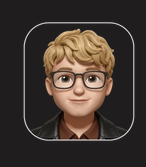

<picture>
  <source media="(prefers-color-scheme: dark)" srcset="./assets/header-dark.svg">
  <source media="(prefers-color-scheme: light)" srcset="./assets/header-light.svg">
  
</picture>

 

  
  
  

<table>
<tr>
<td width="140" valign="middle" align="center">
  
</td>
<td valign="top">

### Hi, I'm Max 👋

Front-end developer working daily with **React** and **Next.js**. Full-time at **[Indico+](https://indicoplus.pl)** since 2025, where I've recently started taking on backend work in **.NET / C#**. After hours I build websites and online stores for clients, and I'm also a student.

I care about performance, polished UI and code that actually earns its keep — not just looks good in a repo.

</td>
</tr>
</table>

---

### `> stack`

  
  
  
  
  
  
  

  
  
  
  
  

### `> currently learning`

  
  
  

---

### `> working on`

**[Tradelog](https://github.com/Matrix669/Tradelog)** — a crypto trading journal that pulls trades from the OKX API. My playground for building a real backend in .NET.

---

  More work, case studies and contact → <a href="https://maxtkaczyk.pl"><b>maxtkaczyk.pl</b></a>

